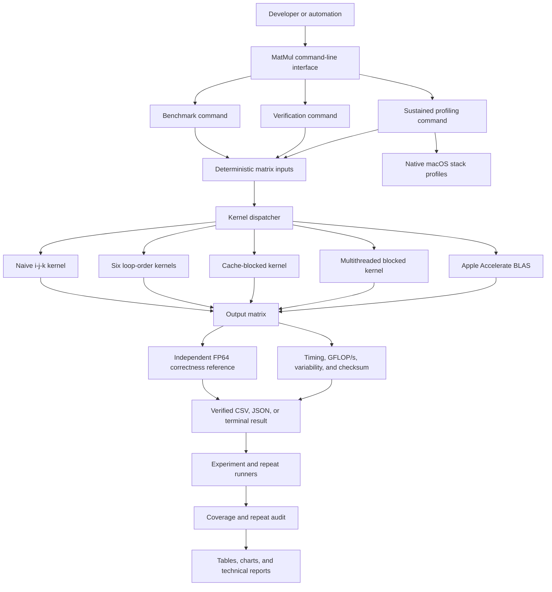

# MatMul

MatMul is a C++20 project that explores how to make matrix multiplication
faster on a CPU without changing the answer.

It starts with a simple implementation, then improves it step by step using
better memory access, cache blocking, compiler optimization, and multiple CPU
threads. On macOS, the custom implementations are also compared with Apple's
highly optimized Accelerate library.

The project is both a working matrix-multiplication program and a practical
performance-engineering study.

## Why I built this

Matrix multiplication is used throughout machine learning, computer graphics,
robotics, simulations, and scientific computing. It is also a useful way to
learn why two programs that perform the same arithmetic can have very different
running times.

I built MatMul to learn and demonstrate how to:

- write safe, modern C++ for numerical workloads;
- understand CPU caches, memory access, vectorization, and threads;
- benchmark software without relying on a single timing result;
- keep optimized code numerically correct;
- use profiling and measured evidence to explain performance;
- compare a custom implementation fairly with a production library.

This gives me a strong foundation for future work in ML systems, GPU kernels,
accelerator software, edge AI, robotics, and computer architecture.

## What I developed

The project includes:

- A contiguous, row-major FP32 matrix container.
- Deterministic random inputs so every implementation receives the same data.
- An independent higher-precision correctness reference.
- Six matrix-loop orderings for studying memory access.
- Cache-blocked multiplication with support for incomplete edge tiles.
- Multithreaded multiplication using independent output-row ranges.
- An Apple Accelerate BLAS comparison on macOS.
- A benchmark runner with warm-ups, repeated samples, medians, variability, and
  GFLOP/s calculations.
- Debug, AddressSanitizer, UndefinedBehaviorSanitizer, and ThreadSanitizer builds.
- Automated experiment, resume, audit, plotting, and profiling tools.
- CSV and JSON output containing compiler, machine, workload, accuracy, and
  timing information.

## The approach

The implementations were developed in stages:

1. **Create a correct baseline.** Build the matrix container, simple `i-j-k`
   multiplication, tests, and an independent numerical reference.
2. **Build a trustworthy benchmark.** Generate inputs before timing, warm up the
   kernel, retain every measured sample, and report the median instead of one
   lucky run.
3. **Improve memory access.** Test all six loop orders and observe how accessing
   contiguous memory changes performance.
4. **Use the CPU cache more effectively.** Divide matrices into smaller blocks
   and test multiple block sizes.
5. **Study compiler optimization.** Compare `-O0`, `-O2`, `-O3`, fast-math, and
   an isolated vectorization-disabled build.
6. **Use multiple CPU cores.** Split output rows between threads, verify that
   writes do not overlap, and measure scaling from one to eight threads.
7. **Compare with an industry implementation.** Use Apple Accelerate as the
   optimized BLAS baseline while keeping an independent correctness check.
8. **Profile and audit.** Capture native stack samples, repeat selected tests in
   separate processes, validate study coverage, and generate final charts.

Every optimization was required to pass the same correctness checks. A faster
result was not accepted if it produced an invalid numerical result.

## Implementation design

The diagram below shows how the main parts of MatMul work together. The C++
program handles matrices, multiplication, correctness checks, and individual
benchmarks. The Python tools run larger studies and turn the saved measurements
into audited reports and charts.



The timed section contains only the selected multiplication operation. Input
creation and final correctness checking happen outside that section. This keeps
the comparison focused on the kernel while still rejecting incorrect results.

## Results

The completed study contains:

- **432 of 432** planned benchmark workloads completed and audited;
- **462** additional repeat observations;
- **894 total** recorded benchmark observations;
- **154 configurations** measured in four independent process-level sweeps;
- **82 Python tests** passing;
- all C++/CLI tests passing in Debug, ASan/UBSan, TSan, and profiling builds;
- four native macOS stack profiles: naive, reordered, blocked, and parallel;
- final performance, scaling, block-size, compiler, and numerical-error charts.

Representative O3 results on the tested Apple M1 Pro are shown below. For
blocked and parallel implementations, the best measured block size or thread
count is used at each matrix size.

| Matrix size | Naive | Reordered | Best blocked | Best parallel | Accelerate |
|---:|---:|---:|---:|---:|---:|
| 128 | 2.665 | 32.023 | 31.926 | 34.077 | 890.794 |
| 512 | 1.802 | 25.639 | 23.733 | 86.892 | 1989.944 |
| 1024 | 1.598 | 25.575 | 21.255 | 99.820 | 1928.733 |
| 2048 | 0.572 | 22.976 | 18.147 | 82.069 | 1413.772 |

Values are GFLOP/s. At size 2048, the best custom parallel result was about
143.5 times faster than the naive version. Apple Accelerate was still about
17.2 times faster than the best custom result.

That remaining gap is expected. Production BLAS libraries use techniques beyond
this project's scope, such as packed data layouts, architecture-specific SIMD
microkernels, careful register use, and highly tuned thread management.

The results describe one machine and should not be treated as universal CPU
performance numbers. The complete methodology and limitations are recorded in
the technical report.

## Documentation

Start here if you want to understand the project in more depth:

- [Final technical report](reports/final-report.md) — methodology, measurements,
  findings, failed experiments, and limitations.
- [Experiment log](reports/experiment-log.md) — predictions, observations, and
  decisions made during development.
- [Coverage audit](results/final/audit/coverage.md) — proves that all 432 planned
  workloads were completed and validated.
- [Repeat analysis](results/final/repeats/repeat_report.md) — explains repeat
  measurements and experimental uncertainty.
- [Profiling evidence](traces/README.md) — summarizes the captured stack profiles
  and what they can and cannot prove.
- [Original roadmap](MatMul_Phase_1_Project_Roadmap.md) — the full project
  requirements and milestone plan.

Generated charts and their supporting tables are in
[`results/final/figures`](results/final/figures/).

## Build and test

You need a C++20 compiler, CMake 3.20 or newer, and a threading library. On macOS,
Apple's command-line development tools provide the compiler and Accelerate.

```sh
cmake -S . -B build/release -DCMAKE_BUILD_TYPE=Release
cmake --build build/release --parallel 4
ctest --test-dir build/release --output-on-failure
build/release/matmul verify
```

If CMake is not installed globally, the included Python environment can provide
the build and analysis tools through [uv](https://docs.astral.sh/uv/):

```sh
uv sync --extra dev --extra analysis
uv run cmake -S . -B build/release -DCMAKE_BUILD_TYPE=Release
uv run cmake --build build/release --parallel 4
uv run ctest --test-dir build/release --output-on-failure
```

## Run a benchmark

```sh
build/release/matmul benchmark --implementation naive --size 512
build/release/matmul benchmark --implementation reordered --size 512
build/release/matmul benchmark --implementation blocked --size 512 --block-size 64
build/release/matmul benchmark --implementation parallel --size 1024 --threads 8
build/release/matmul benchmark --implementation accelerate --size 1024
```

For a rectangular multiplication:

```sh
build/release/matmul benchmark \
  --implementation blocked --rows 128 --inner 1024 --cols 64 --json
```

Use `matmul list` to see available implementations and
`matmul --help` for command-line options.

### What the benchmark numbers mean

- **Median time:** the middle measured duration, which is less sensitive to one
  unusually slow or fast run.
- **GFLOP/s:** billions of floating-point operations per second. Higher is better
  for the same workload.
- **Maximum error:** the largest observed difference from the correctness
  reference.
- **Standard deviation:** how much the saved timing samples vary.
- **Effective bandwidth:** a lower-bound estimate based on required matrix data;
  it is not a direct measurement of physical memory traffic.

Input generation, result checks, and output formatting are excluded from kernel
timing. Output clearing and thread creation are included because they are part of
the current multiplication implementations.

## Reproduce the complete study

The following command builds and tests every required configuration, runs the
study and selected repeats, validates coverage, creates charts, and captures
profiles:

```sh
uv run --extra dev --extra analysis python scripts/complete_project.py \
  --profile-backend sample
```

A new run can take hours. Matching completed observations are resumed instead of
being deleted or measured again. Use `--dry-run` to inspect the planned commands
without running them.

The built-in macOS `sample` profiler works with the command-line tools. Full
Xcode is required for the optional Instruments backend. Stack samples are not
hardware counters, so the project does not claim measured cache-miss or CPU-stall
rates.

## Project layout

```text
include/matmul/   Public C++ interfaces
src/              Matrix container, kernels, benchmark, profiling, and CLI
tests/            C++ and Python correctness/tooling tests
scripts/          Experiment, audit, analysis, plotting, and profile tools
results/final/    Audited measurements, repeat analysis, and charts
reports/          Experiment log and technical reports
traces/           Native profiling evidence
```

## Scope and limitations

MatMul is an educational and portfolio performance-engineering project. It
is not intended to replace Apple Accelerate or another production BLAS library.
The current engine supports FP32 CPU multiplication; it does not include GPU
kernels, alternate numeric types, or a persistent thread pool.

Those limitations also create clear follow-up directions: GPU/Metal kernels,
quantized matrix multiplication, ML operators, a reusable worker pool, and an
FPGA matrix accelerator can all reuse the project's correctness and benchmark
methodology.
